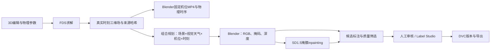

# 受控火焰合成：实现与使用

更新：2026-10-23。此记录针对新增受控合成入口，旧任务及其产物保持原样。

## 在页面中使用

1. 在3D编辑页布景、设置燃烧和求解参数，直接开始作业，查看原始MP4及对应物理时序。
2. 打开同页右侧的“数据合成”。选择已完成的一个或多个FDS工况，可跨室内外场景。
3. 勾选视觉天气、机位、真实采样时刻数和增强模式。点击“预览组合数量”，确认后“开始合成”。修改选项后必须重新预览。
4. 在同页看运行状态、基础渲染前后对照、原图/增强图、掩码和深度；在“作业”看阶段日志、取消或重试。
5. 进入“样本与标注”人工复核，随后使用已有Label Studio、数据集版本与COCO/YOLO导出入口。自动筛选通过不等于人工标注验收。

## 实际链路

FDS只负责物理工况。曝光、相机、视觉天气和增强参数变化复用已校验的三维场，不重复求解。采样只取已有且存在燃烧的真实时刻；不通过复制视频帧制造观测。雨雪当前为视觉效果，不改变FDS热传递或燃烧条件。

基础渲染提供原始黑体映射与清晰可视化映射。新映射调整烟密度增益、反应区发光阈值/增益及曝光，保存全部参数和同场同机位对照；这是未标定的可视化映射，不能把渲染亮度当成温度测量。新的视频作业也使用此映射，已有视频不会被替换。

背景增强保留火焰保护区原像素；火焰外观增强仅修改火焰附近区域，重新提取暖色候选掩码，并检查与原掩码的重叠。两者调用真实掩膜inpainting，保留原图、父子关系、权重哈希、种子、编辑区域和推理参数。候选掩码是启发式标签，仍需人工审核。模型内容过滤保持开启，被拒样本显示原因。

增强结果是训练候选静态图，标记为非物理真值；不修改原始FDS场或MP4，不作为经过验证的连续预测序列。

## 模块边界与接口

- `fire_modeling/synthesis_contracts.py`：纯组合规划和渲染配置；不依赖数据库、HTTP或扩散库。
- `platform_api/synthesis.py`：权限、来源校验、预览/提交、结果及文件接口；不包含推理或渲染节点代码。
- `fire_modeling/synthesis_pipeline.py`：消费版本化计划和场清单，执行渲染/增强、缓存、产物校验。
- `fire_modeling/controlled_augmentation.py`：扩散模型适配、掩膜编辑与派生标签。
- `platform_api/worker.py`：按阶段调用现有Compose引擎；完成校验后注册到原有Run、审核及版本链。

API前缀为`/api/projects/{project}/synthesis`：`GET /capabilities`检查权重；`POST /preview`返回组合及计划哈希；`POST /`提交一致的计划；`GET /jobs/{id}/result`读取状态/对照；`GET /jobs/{id}/files/{relative}`读取许可清单中的文件。沿用项目权限和登录，不新增第二套账户或数据库。

重试校验计划、来源和产物哈希，复用完整渲染及已成功增强样本。单组合重跑只规划所选工况/天气/机位。全被拒绝或缺图不会标为成功；部分拒绝明确列出，保留有效原图。

## 已跑通的真实验证

作业`6de9f0e8056f224d0e7020a5`复用室内20秒与室外5秒两个已完成FDS工况，执行晴/雾、侧视/俯视及一个真实时刻：8张基础渲染、16张真实SD1.5增强，共24张候选，拒绝0，自动筛选通过24。另以作业`b1c31431a7af3392603d925c`完成雨/雪两个视觉条件的实际渲染（2张原图）。执行阶段只有组合渲染和掩膜增强，没有新增FDS求解。样本均保留待人工审核状态；没有自动批准或发布数据集。

基础对照、RGB、深度、掩码、模型参数及质量记录保存在`artifacts/platform/jobs/6de9f0e8056f224d0e7020a5/`。机器可读证据见`artifacts/platform/synthesis-verification.json`。

## 尚未通过的部分

- ControlNet深度适配代码已接入，但本机未安装对应权重：官方站及镜像下载连接失败，页面禁用该选项。当前真实验证使用掩膜inpainting，不宣称运行了ControlNet。
- 当前沿用本地SD1.5基础权重的4通道inpainting路径，尚未验证专用inpainting检查点；后续可在增强适配层替换模型。
- 尚无独立真实火焰测试集与人工参照，未完成光学标定、标签精度、分布相似度、检测提升及预测泛化验收。视觉更明显不等于算法验收通过。
- 未实现有时间一致性保证的视频扩散增强。原始FDS时序可用于构造训练序列；预测能力仍需要独立训练和留出工况评价。

回归：101项测试通过，Python范围覆盖率73.33%；主平台TypeScript/生产构建及原编辑器生产构建通过。浏览器验证数量预览、结果对照/筛选、真实图片加载和任务阶段；390px页面未出现水平溢出，复杂3D操作仍以桌面为主。
