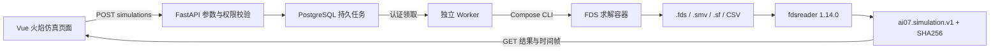

# 火焰物理仿真接入

日期：2026-10-21。入口：http://localhost:3000/#simulation 。适用于课程本机研究，不作为消防工程安全设计依据。

## 采用什么项目

- [firemodels/fds](https://github.com/firemodels/fds)：实际调用的火灾CFD求解器，当前固定的安装包为FDS 6.11.1，保留原始安装包校验和与求解日志。
- [FireDynamics/fdsreader](https://github.com/FireDynamics/fdsreader)：实际安装1.14.0，用于读取FDS二进制切片。通过独立包调用，没有复制其源码；许可证与引用见其上游仓库。
- [usnistgov/FD-Gen](https://github.com/usnistgov/FD-Gen)：参考参数化FDS工况组织；当前由本项目的SceneConfig生成受校验的单工况，不声称移植完整FD-Gen。

FDS本身是命令行求解器。本项目提供REST接口作为Web与求解器之间的适配层，不直接将GitHub页面嵌入平台，也不要求前端安装Fortran或Python库。

## 实际接口与数据链路



- `GET /api/simulation-engines`：采用的开源引擎、读取库、接口契约与资源上限。
- `POST /api/projects/{project}/simulations/preview-input`：按配置预览`.fds`文本，不执行求解、不创建任务。默认项目允许只读访客使用。
- **`POST /api/projects/{project}/simulations`**：提交物理仿真，返回任务ID。要求登录、项目成员和产品经理/架构师/开发工程师角色；幂等键避免重复点击创建任务。
- `GET /api/projects/{project}/simulations`：获取该项目独立仿真列表及排队、运行、完成、失败状态。
- `GET /api/simulations/{id}`：获取结果摘要、物理量、单位、色标范围、帧时间和源文件SHA256。
- **`GET /api/simulations/{id}/fields/{field}/frames/{frame}`**：获取温度`temperature`、烟炱密度`soot`、速度大小`velocity`的指定帧。`frame`为从0开始的帧序号，不是秒数；响应的`time_s`为实际求解时间。
- `GET /api/simulations/{id}/input`：下载该已完成任务真正使用的FDS输入文件。
- `POST /api/jobs/{id}/cancel`、`POST /api/jobs/{id}/retry`：复用现有取消/重试接口。

内部接口`POST /api/internal/claim`、`POST /api/internal/jobs/{id}`只供带工作密钥和租约的Worker使用，不向前端提供密钥。Swagger说明位于 http://localhost:3000/docs 。写入请求需要浏览器登录会话和合法Origin。

提交JSON示例（`config`使用现有场景完整配置；此处展示调用结构）：

```python
# session先通过现有/api/login获取本地会话；不使用共享硬编码密码。
job = session.post(base + '/api/projects/ai07/simulations', json={
    'name': '室内物理试验',
    'config': scene_config,
    'idempotency_key': 'caller-generated-unique-request-key'
}).json()
# 完成后读取job['id']对应结果；排队/失败时不读取为成功。
```

## 模块边界

`fire_modeling/physics.py`生成输入并检查FDS完整结束；`workflow.py simulate-web`完成求解与结果导出；`simulation.py`封装fdsreader和输出契约；`platform_api/worker.py`只负责调度；`platform_api/app.py`提供权限、任务和受限文件读取；Vue的`SimulationPanel.vue`只消费JSON。API进程不加载fdsreader、bpy或torch，Docker socket也不挂给Web/API。

每项独立任务存放于`artifacts/platform/jobs/{id}/physics/`，原始文件不覆写。每个物理场保留单位、实际时间、XZ坐标、y位置和原始尺寸。JSON显示最多41帧、每帧96×96节点，采用最近网格抽样，不做平滑增强；色标固定为该物理量完整时段范围，禁止把烟密度与温度共用单位。当前只支持模板输出的单网格XZ切片，不支持用户任意上传`.smv`文件；禁用pickle缓存反序列化。

独立仿真不消耗扩散模型GPU或付费LLM Token；单次限制120000网格和60秒物理时长。生成、标注、SD增强、DVC发布仍使用原有流水线。原来的Blender路径仍是HRR视觉代理；三维全场到Blender/OpenVDB的转换不在本次已实现范围。

## 启动与离线更新

常规启动使用`./scripts/start-platform.ps1`。变更求解适配器后先执行`docker compose build physics`。

若Docker Hub临时无法连接，而本机已有`ai07-platform:web`镜像与`web/node_modules`，可使用当前运行镜像离线更新前端（不能用于全新机器）：

```powershell
npm --prefix web run build
docker build -f web/Dockerfile.local -t ai07-platform:web web
docker compose --env-file .cache/platform/compose.env -f compose.yaml -f compose.platform.yaml build platform-api
docker compose --env-file .cache/platform/compose.env -f compose.yaml -f compose.platform.yaml up -d --no-build platform-api platform-web annotation-platform
```

然后运行或保留一个`python -m platform_api.worker --api http://127.0.0.1:8092`进程。不要重复启动多个Worker；原始输入与数据卷均保留，不运行卷删除命令。

## 本次真实验证

任务`84a0d73ded4a5aec6aac2300`明确标注为接入联调，由维护脚本入队、独立Worker执行；未替用户创建账户。浏览器提交接口另通过隔离接口测试验证。求解器FDS 6.11.1、读取库1.14.0；工况时长5秒，每场11帧，原始数组11×21×16，页面16×21节点。

温度全时段峰值286.4326°C，烟炱密度峰值4.9057e-5 kg/m³，速度大小峰值4.1169m/s，来自本次实际输出。上述数字是该粗网格工况的观测结果，不代表独立精度验收。真实数据分布相似度和下游检测收益仍需独立数据评价。

测试报告和浏览器证据见`artifacts/platform/simulation-verification.json`及`artifacts/platform/screenshots/simulation/`。SRS保持不变。
