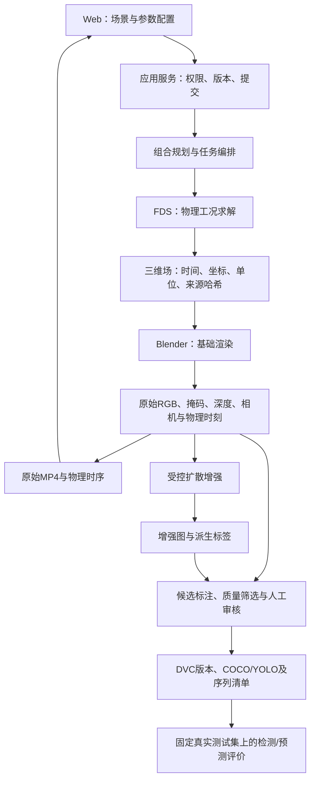

# 火焰合成链路实现方案

本文件保留链路设计及实施顺序。组合规划、可配置渲染、同源深度/掩码、两种掩膜inpainting、编辑页入口及标准Run交接已实现，并完成真实小批量验证；ControlNet权重、物理标定及真实数据效果评价仍待完成。具体状态见[实现与验证](受控合成实现与验证.md)。

## 1. 一条主链，两个结果分支

FDS是唯一物理来源。原始视频与时序参数展示其求解过程；生成式增强生产额外训练图像。两类结果在界面和清单中明确区分。未经验证的逐帧扩散图不作为连续物理预测序列。

## 2. 六个模块的职责

### 编排模块

接收场景修订和用户选项，生成完整组合清单、估算数量、复用缓存、创建阶段任务、处理取消及重试。只依赖求解、渲染和增强的公开接口，不包含Blender节点或扩散推理代码。

### 物理模块

负责FDS输入、网格/边界校验、求解和三维场导出。输入包括几何、材料/等效燃料、火源、通风/风场、网格和时长；输出包括物理时间、坐标、单位、场数据、求解配置及版本。相机、色调和生成提示词不进入该模块。

### 渲染模块

消费已校验的场数据，负责坐标映射、体积材质、曝光、相机、渲染天气和视频编码。输出RGB、候选掩码、深度/结构控制图、相机参数和逐帧对应关系。画面配置独立版本化，调整画面时复用原物理场。

### 增强模块

消费原图、掩码、深度/边缘和增强配置，负责扩散推理、区域约束及模型来源记录。输出新图及编辑区域、父样本ID、模型哈希、种子和标签处理策略。通过同一个增强接口支持背景增强和后续火焰外观增强。

### 标注与质量模块

负责候选框/掩码、文件及来源检查、可见性/图像异常检查、结构与标签一致性、人工复核和Label Studio往返。记录通过、拒绝及原因，不通过修改源场来修补图片。

### 数据集模块

负责样本索引、血缘、按物理工况分组划分、版本冻结、DVC及导出。读取审核后的标准清单，不依赖FDS输出文件的内部格式或扩散库。

六个模块部署为现有FastAPI模块化应用＋Worker＋Compose引擎容器。PostgreSQL保存任务/索引/审核记录；大型场、模型和图片保存在产物目录，以哈希关联。当前阶段不新增消息中间件或独立模块数据库。

## 3. 先固定交接契约

使用四类有版本号的清单，由独立契约层定义；阶段内部Python对象不跨容器直接传递。

- `PhysicsArtifact`：`case_id`、场景修订、物理配置、FDS版本、网格、单位、坐标系、真实时间轴、字段路径及哈希。
- `RenderArtifact`：`sample_id`、物理工况ID/场帧哈希、物理时刻、机位/相机变换、视觉天气、RGB/掩码/深度及哈希、Blender及材质配置版本。
- `AugmentArtifact`：新样本ID、父样本ID、模式、模型/提示词/种子/推理参数、控制图哈希、新图、新标签策略、审核状态。
- `DatasetManifest`：样本及来源索引、共同来源组ID、训练/验证/测试划分、审核记录、导出格式和版本哈希。

每阶段先写临时产物，完成格式、数量和哈希校验后再发布成功清单；下游只消费已发布清单。失败保留日志与有效上游结果，重试从失败阶段继续。部分成功明确列出被拒组合，不以总任务“完成”掩盖缺图。

缓存键分别由物理配置/几何材料及FDS版本、场帧哈希/相机天气及渲染配置、原图控制图哈希/模型及增强配置计算。缓存命中仍检查文件哈希及项目访问权限。

## 4. 多条件合成由组合清单驱动

先列出所有请求组合，而后执行，不靠样本数量循环猜测组合。

示例仅用于说明：2个场景 × 2种视觉天气 × 3个机位 × 5个时刻＝60张原图。每张生成2张增强图，则额外120张、总计180张；实际通过数量由质检决定。

改变相机、背景雾或视觉光照，复用相同FDS工况。改变风场、通风、燃料、火源或物理天气条件，创建新的FDS工况。雨雪的视觉表现与雨雪对燃烧的物理作用分开标记；后者没有模型支持时明确拒绝。

用户可在提交前查看预计工况数、原图数、增强数和网格预算。若预算不足，明确缩减选项。无火负例应作为显式无火工况或单独标记的视觉负例，不在正样本循环中隐式关闭火焰。

## 5. 基础渲染优先修复

用同一FDS帧、相机和种子固定对照，检查场范围、坐标、反应区阈值、烟炱密度、发光映射、曝光和物体遮挡，再调整空间分辨率及采样。保存原始配置、修改配置、对照图片和场哈希，确保画面改进可以复查。

HRRPUV截止值、消光/发光增益已移入`RenderProfile`，记录其未经实验校准的状态。通过原图、掩码、场切片和物理参数联合排查火焰不明显的原因。粗网格带来的细节损失需要调整工况域与网格，不能靠增加视频编码帧恢复。

## 6. 两种受控增强模式

### 背景增强

固定火焰及保护区，使用掩膜修复与深度/边缘条件生成环境。验证保护区像素或形状约束、场景结构及新增遮挡。只有检查通过时才允许沿用火焰候选标签，仍进入人工审核。

### 火焰外观增强

以原火焰掩码和结构控制图限制生成范围，增加火焰纹理、颜色和烟火外观变化。输出编辑区及新候选掩码/框，检查轮廓漂移、漏标、多余火焰、遮挡和细节。火焰轮廓发生变化时重新标注；无法可靠标注则拒绝该候选。

先验证现有公开预训练模型能否在受控区域内产生可用火焰外观；若效果不足，再评估有许可的火焰数据及专用适配权重。接口和按钮不作为模型有效性的证据。增强图关联原物理工况以保留来源，其新增外观不升级为CFD真值。

新增入口已使用SD1.5掩膜inpainting，实现深度输出、背景保护和火焰外观增强及候选检查；ControlNet适配器已实现但权重未安装，页面禁用。旧img2img路径仅保留兼容历史任务。Diffusion作为07的生成增强实现，暂不同时增加GAN。

## 7. 页面保持一条操作路径

3D编辑页保留“开始仿真”，在页内查看原始MP4、时轴和物理参数。已完成仿真下提供“合成训练数据”，展开场景/视觉天气/机位/时刻/增强模式及预计数量，提交后仍在该场景查看进度。

结果按原始/增强筛选，支持同一父图前后对比，并进入审核。任务中心保留跨场景管理、取消及重试。页面调用应用API，只接收状态、预览和下载地址，不读取容器内部路径，也不负责调度引擎。

## 8. 在现有代码上的实施顺序

1. 先拆出契约和组合规划器，给出组合覆盖、确定性ID、缓存失效、权限和负例边界测试。现有`pipeline.py`的数量循环逐步替换为明确的渲染条目。
2. 完成`RenderProfile`、RGB/掩码/深度同源输出及固定帧对照，解决基础火焰可见性；原时序播放器继续消费原始结果。
3. 将`enhancement.py`拆成增强接口和模型适配器，接入受控背景增强、再验证火焰外观增强。`workflow.py`只组装模块，`worker.py`只调度阶段。
4. 通过标准候选清单接入现有质检、Label Studio、DVC和COCO/YOLO导出；增加增强标签一致性及序列用途标记。
5. 将合成入口接到编辑页，展示组合覆盖和父子图对照，完成一组小规模端到端实跑，再扩展批量。
6. 获得独立真实测试数据后，固定检测模型及训练条件，比较仅真实数据和真实＋合成数据，报告收益与失败情况。

每一步均产出可验证结果。组合完整性、哈希校验和无伪造成功状态是交付条件；图像指标及检测收益以真实实验报告，不预设无法保证的提升值。
