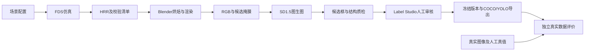

# 火焰数据集算法建模说明

## 参数化模型

统一坐标采用米，地面z=0，火源为地面矩形。热释放率单位kW，FDS面热释放率为`HRRPUA = peak_hrr_kw / burner_area_m2`。初始时间到`ramp_up_s`线性增长，随后保持峰值。温度采用摄氏度，风速采用m/s；室内模板用门洞通风，不接受未实现的室内强制风。网格、火源边界对齐，坐标、有限数值及资源规模均有校验。

室内为带门房间；室外为底面固体、侧面和顶部开放的计算区域。有风时指定入流边界。湿度、复杂材料热解及多燃料尚未建模，不提供看似可调但对结果不起作用的参数。

## 物理计算与视觉代理

FDS本身承担流动、燃烧及烟热计算，代码只生成工况、运行引擎和解析结果。真实仿真成功要求正常退出、HRR文件有效且时间覆盖终点；保留温度、SOOT密度和速度切片，以及一个温度测点输出。当前不解析FDS切片二进制网格供渲染使用。

视觉映射为`strength = clip(HRR_kW / 100, 0, 3)`，只将指定时刻的HRR映射到视觉燃料强度。FDS和Mantaflow是独立求解器，其单位和离散过程不能按视觉效果直接等同。没有真实HRR时明确记录`configured_hrr_not_solved`；没有时段覆盖时禁止外推。

Blender路径使用Mantaflow气体域、火焰/烟雾流入源、32级基础分辨率和24帧缓存，Cycles输出RGB及火焰发光候选通道。图像雾化是视觉合成，不表示FDS湿度计算。该通道受体渲染、烟雾和阈值影响，只能产生候选框，不能直接保证物理或标注精度。

## 本机可运行的预览模型

为在缺少外部引擎时验证数据流程，使用简化浮力粒子模型。每步在火源区域采样粒子，温差驱动竖直加速度`a_z = g × ΔT / (T_ambient + ΔT)`，同时施加阻尼、温差指数衰减和水平随机扰动。相机透视投影后，粒子以温差控制的高斯光斑叠加，累计透明度形成候选火焰掩膜；负样本仍含暖色干扰物，但不产生火焰掩膜。

这是可复现的程序化视觉基线，未求解完整流体方程、辐射或化学反应，不能作为CFD数据、实测温度或算法效果证明。每个独立粒子轨迹及其视角、天气和增强后代作为同源组；真实FDS路线全部视角跟随同一工况组。

## 生成增强

传统路线仅改变亮度、对比度、模糊和噪声，记录随机参数，明确标记为传统增强。

扩散路线使用本地预训练Stable Diffusion图生图管道，输入原图、提示词、强度、步数和随机种子；加载本地权重并保存文件SHA-256。通过固定噪声种子控制随机过程，不声称跨硬件逐像素一致。不在当前阶段重新训练扩散模型，也不承诺火焰轮廓保持不变。继承的父掩膜只能预标注，必须经人工检查修正后发布。

## 标注与数据模型

候选掩膜阈值化后计算连通区域，过滤很小区域，求像素外接矩形。统一内部格式为`[x0,y0,x1,y1]`，COCO输出`[x0,y0,width,height]`且类别为1，YOLO输出归一化中心和宽高且类别为0。无火图像具有空标签。

质量门禁检查文件、尺寸、SHA-256、坐标和重复图像；亮度和拉普拉斯方差只作为诊断统计，不自动等同于真实感。人工修订保留历史，发布只取审核通过的图像和标注快照，增强图不继承审核通过状态。数据按同源组固定划分，版本内冻结图像、标签及输入清单。

## 检测模型与评价

本地学习基线使用9维RGB及交互特征，依据人工框产生弱像素监督，训练带类别平衡和L2项的逻辑回归。固定采样像素数与梯度步数，通过概率阈值、连通域和外接框得到检测结果。它验证可学习算法接口，但不能代表现代检测器精度。

真实检测路径调用Ultralytics YOLO，从同一份本地权重分别训练真实数据组与混合数据组，共享验证和测试集、随机种子与训练参数。通过训练列表采样对齐规模，同时报告实际迭代数。需提供获授权的真实图像及人工标签，当前仓库不包含真实消防数据或预训练模型。

检测评价在所有预测置信度排序上计算101点插值AP，另在固定阈值统计Precision、Recall和负图误报。完整YOLO实验采用其评估器，记录模型权重、配置和两组差异。小样本与训练数据自评只能验证流程，不能证明真实泛化收益。

真实FID使用Inception特征，固定特征维度、样本数和预处理。小样本FID-64不能和2048维FID混比；RGB直方图JS是另外一种诊断，不可冒称FID。物理误差按相同单位和时间窗口计算`sum(abs(pred-ref))/sum(abs(ref))`，参考全零时指标未定义；必须提供独立实测或验证参照，不能用自身输出证明仿真误差≤5%。

## 外部验证范围

自动化测试覆盖配置、单位转换、候选框、确定性、分组、防止未审核发布、旧版本冻结、格式导出、真实数据导入、指标公式和失败状态。FDS运行控制使用模拟进程测试，不能当作FDS真实集成验证。Blender、扩散模型、FID特征模型及YOLO真实训练须在安装外部依赖后另行运行并保留产物。

接口参考：[FDS官方文档](https://pages.nist.gov/fds-smv/manuals.html)、[Blender流体API](https://docs.blender.org/api/current/bpy.types.FluidDomainSettings.html)、[Diffusers图生图](https://huggingface.co/docs/diffusers/api/pipelines/stable_diffusion/img2img)、[Ultralytics训练](https://docs.ultralytics.com/modes/train/)、[pytorch-fid](https://github.com/mseitzer/pytorch-fid)。
## 容器阶段契约

`assets`只负责外部资源准备；`physics`只负责FDS；`blender`只负责场景和渲染；`enhance`只负责扩散；`modeling`处理审核记录与数据版本；`gpu`执行评价。服务之间不互相导入运行库，通过共享产物目录和JSON清单交接。

工程化验收关注各阶段真实运行、来源可追踪、出错即停止、审核后才能发布。算法效果验收需独立实测数据，不能把链路运行成功写成物理精度或检测收益达标。
