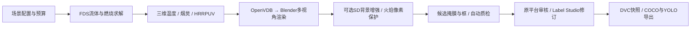

# 统一火焰数据制作链路

主入口：<http://localhost:3000/#simulation>。在当前Vue平台内配置、生成和看火焰，不需要进入FirePhantom独立账户。

## 四步操作

1. **仿真与合成**：选室内/室外，设置热释放率、时长、网格、512/768像素及采样数；展开设置视角、视觉天气和随机种子。点击“开始仿真与合成”。后台队列串行运行；任务中心支持日志、取消和失败重试。
2. **直接看火焰**：同页“火焰预览”选择结果批次、图像和播放结果帧。每帧标出视角、天气、实际求解时间与来源。播放是结果序列浏览，可能切换相机，不称固定相机视频。展开物理观察可查看同批温度、烟炱、速度和HRR；也可仅提交FDS试验。
3. **检查标注与质量**：进入该批次，按自动筛选结果过滤，查看/修改候选框；需要时同步Label Studio并导入人工标签。保护火焰像素不代表背景没有伪火，增强图始终重新审核。
4. **版本与导出**：仅纳入人工通过样本，冻结图像、标签、来源和分组，执行DVC add、Git commit、DVC push，再下载COCO/YOLO。研究快照不能当作课程算法验收成绩。

## 模块与文件契约

- Vue只调用FastAPI；场景、队列、Run、样本、审核、DVC沿用原平台。没有第二套业务数据库或账户。
- Worker领取任务，固定参数调用Compose中的physics、blender、enhance容器。Web进程不加载bpy、FDS或torch。
- FDS保留输入、执行状态、日志、HRR和真实3D SLCF；fdsreader输出`physics/volume/volume.json`及逐帧NPZ（XYZ轴顺序、米、摄氏度、kg/m³、kW/m³，SHA256）。同源物理工况的全部视角、时间和增强图留在同一数据组，禁止跨训练/测试集。
- Blender自带OpenVDB读取逐帧浮点场，保留坐标与网格间距，分别生成原始RGB、发光掩膜和`render.json`。使用HRRPUV控制发光区、温度映射颜色、烟炱控制消光。VDB按源文件及缓存哈希复用，多相机不重复FDS求解，无需第二次Mantaflow模拟。
- SD使用已安装的本地SD1.5 img2img，渲染火焰掩膜膨胀后保护并羽化合成；逐像素恢复保护区。它不是专用inpainting或ControlNet模型，不宣称整个画面保持物理正确。模型SHA256、提示词、种子、父图与保护策略随样本保存。
- 自动质检核对图片、尺寸、哈希、框合法性和精确重复；有火样本缺候选框进入质量警告。自动筛选通过与人工通过分开，质量统计不等同于真实感评分。
- 完成门禁核验FDS交接、三维场哈希、样本来源和Blender实际渲染后端；缺失或回退不能把新链路标成成功。

## FirePhantom如何融入

保留`integrations/firephantom`作为提供代码的可追溯来源；适配其体积/黑体材质组织、相机分离、缓存、火焰保护与背景重绘方法，重写为原平台文件契约。实现位于`fire_modeling/fds_volume_scene.py`、`volume.py`、`enhancement.py`、`workflow.py`和`web/src/components/FlameWorkbench.vue`。无需运行它的React前端、PostgreSQL或登录系统。

此前的8765独立部署是可选对照工具，已从主要操作链路移除。原始目录及导入源码不修改；主项目SRS不覆盖。

## 低成本与边界

默认本地CPU执行FDS/Blender，GPU只执行SD；无付费LLM调用。网格≤120000单元，时长≤60秒，图像≤768像素，采样16–128；三维输出抽样最多41帧。先用2–4张验证，再扩大。关闭SD即可只求解/渲染；增强阶段只复制图像与必要清单，不复制Blender烘焙缓存。

晴/雾和室内/室外均可配置，但视觉雾不等于湿度CFD，室内渲染为便于观察的剖视展示。每5张中的视觉负例隐藏体积，明确标记为“非独立无火CFD工况”；不是物理熄灭模拟。

消光/发光增益及HRRPUV显示截断值记录在`render.json`，仍未使用实测图像标定。提高输出像素不会增加FDS网格细节，低分辨率场仍可能平滑。真实物理误差、标准FID及检测mAP须导入独立真实资料后评价，当前没有可宣称的合格结果。

## 启动与升级

首次安装引擎：`./scripts/update-engines.ps1 -Full`；已有本地镜像仅刷新代码：`./scripts/update-engines.ps1`。然后运行`./scripts/start-platform.ps1`。

Web/API/Label Studio由Compose管理，Windows后台Worker执行Compose任务。普通操作使用现有平台账户。无需启动`start-firephantom.ps1`。

参考接口依据：[fdsreader三维切片](https://fdsreader.readthedocs.io/en/latest/)、[OpenVDB Python网格与数组交接](https://www.openvdb.org/documentation/doxygen/python.html)、[Blender体积导入](https://docs.blender.org/api/current/bpy.ops.object.html)。本实现读取浮点SLCF，未把Smoke3D编码字节误当物理单位。

## 本机实测记录

统一任务 `c427e6790e269e6b8de1b50a` 实跑193.16秒，完成8秒FDS、41×41×31三维场、两张512×512原图、两张真实SD1.5增强图及质检。保护区分别36457/34397像素，均保持一致；4张候选同步Label Studio项目2，图片全部HTTP 200。

增强过渡后续改为只在保护区外侧羽化，避免边缘贴片感；复用原FDS和渲染，只运行SD。原批次已有用户审核，因此修订另存 `cda799988a50178dc6a4fa8b`（“背景过渡修订 · 待复审”）并同步项目3，不覆盖旧图或标签。它仍需重新审核。

79项隔离测试通过，覆盖率77.12%；Vue类型检查与生产构建通过。DVC/导出由隔离测试验证，没有自动批准或发布本批候选。证据：`artifacts/platform/unified-pipeline-verification.json`、`unified-label-studio-verification.json`、`junit.xml`、`coverage.xml`。

复核时版本页已有用户发布的 `v0.2.0-volume-fire`（4张，Git `bac0469de217`），可下载数据集；该版本与人工审核均保留。本轮没有代替用户发布增强修订。
